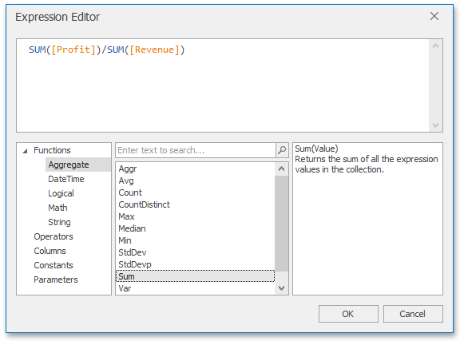
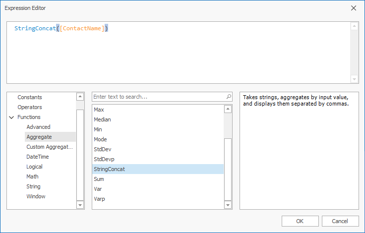

# Summary Level Aggregations
The Dashboard Designer aggregates data when you construct a [calculated field expression](../../work-with-data/creating-calculated-fields.md). This allows you to evaluate calculated fields on a summary level.

In the Dashboard Designer, you can use the following set of predefined aggregate functions:

| Function | Description |
|---|---|
| Aggr(SummaryExpression, Dimensions) | Aggregates underlying data using the detail level specified by a predefined set of dimensions and a specified summary function. For more information, see [Intermediate Level Aggregations](intermediate-level-aggregations.md). |
| Avg(Value) | Returns the average of all the values in the expression. |
| Count() | Returns the number of values. |
| CountDistinct(Value) | Returns the number of distinct values. |
| Max(Value) | Returns the maximum value across all records. |
| Min(Value) | Returns the minimum value across all records. |
| Median(Value) | Returns the median of the values. |
| Sum(Value) | Returns the sum of all values. |
| Var(Value) | Returns an estimate of the variance of a population where the sample is a subset of the entire population. |
| Varp(Value) | Returns the variance of a population where the population is the entire data to be summarized. |
| StdDev(Value) | Returns an estimate of the standard deviation of a population where the sample is a subset of the entire population. |
| StdDevp(Value) | Returns the standard deviation of a population where the population is the entire data to be summarized. |

These functions can be used for all types of numeric fields. After creating such calculated fields, you can use them as measures in an OLAP cube.

## Aggregate Function Support in Server Mode

Support for certain aggregate functions in server mode depends on the database provider.

| Database Provider | Var | Varp | StdDev | StdDevp | CountDistinct | Median | Mode |
| --- | :---: | :---: | :---: | :---: | :---: | :---: | :---: |
| Microsoft SQL Server |  |  |  |  |  | [^1] |  |
| Microsoft SQL Server CE |  |  |  |  |  |  |  |
| PostgreSQL | [^2] | [^2]| [^2] | [^2] |  |  |  |
| MySQL |  |  |  |  |  |  |  |
| Oracle |  |  |  |  |  |  |  |
| SAP HANA |  |  |  |  |  |  |  |
| IBM DB2 |  |  |  |  |  |  |  |
| SAP SQL Anywhere |  |  |  |  |  |  |  |
| SAP Sybase ASE |  |  |  |  |  |  |  |
| Firebird |  |  |  |  |  |  |  |
| Microsoft Access |  |  |  |  |  |  |  |
| SAP Sybase Advantage |  |  |  |  |  |  |  |
| Pervasive PSQL |  |  |  |  |  |  |  |
| Teradata |  |  |  |  |  |  |  |
| SQLite |  |  |  |  |  |  |  |
| VistaDB |  |  |  |  |  |  |  |
| Google BigQuery |  |  |  |  |  |  |  |

  - supported.  
 - not supported.

[^1]: `Median` requires SQL Server 2022 (16.x) or later or Azure SQL.
[^2]: `Var`, `Varp`, `StdDev`, and `StdDevp` are supported in PostgreSQL 8.2 and later.

## Custom Aggregate Functions

Along with the predefined aggregations (like Min, Max, Sum, Avg), the Dashboard supports custom aggregation functions. A custom aggregate function appears in the [Expression Editor](../../ui-elements/expression-editor.md)'s categories if the function was registered in your application.

The following image illustrates the custom _StringConcat_ function in the **Aggregate** function’s category:

Names of custom aggregate functions are stored in the **Custom Aggregate Names** category and can be used as arguments when you create window calculations as _WindowAggregate_ and _RunningAggregate_.

Refer to the following topic for detains: [Calculation Functions Reference](../window-calculations/calculation-functions-reference.md).

